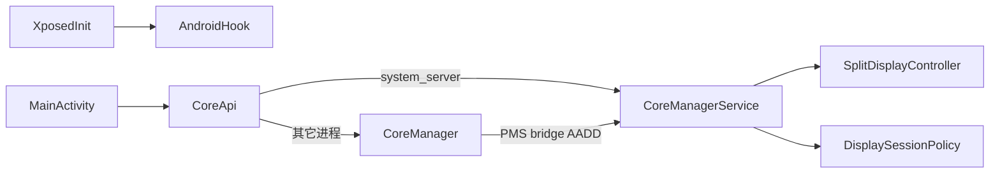

# AGENTS.md — AADisplay

面向后续 AI / 开发者的项目地图与改动约束。改代码前先建立心智模型，避免误动隐藏 API、Binder 桥、VirtualDisplay / AAP / CarPlay 等高风险区域。

**运行时执行顺序（进程、开机→出画、IPC、触控、会话）**：[docs/EXECUTION.md](docs/EXECUTION.md)。改显示 / IPC / 钩子 / 触控 / 生命周期前必读。

## 1. 项目概述

AADisplay 是 [Nitsuya/AADisplay](https://github.com/Nitsuya/AADisplay) 的生产向 fork：通过 **LSPosed** 在系统侧创建 **VirtualDisplay**，把选定手机应用投到 **Android Auto** 车机界面，并提供 AA 侧 UI/DPI/按键等兼容钩子。

| 项 | 说明 |
|----|------|
| 平台 | 仅 Android 手机；出口为 Android Auto 和/或无线 CarPlay（无 iOS / Web / Desktop） |
| 最低系统 | Android 13+（`minSdk 33`），`compileSdk` / `targetSdk` 36 |
| 运行前提 | Root + LSPosed（或兼容 Xposed）；**System Framework 必选**。出口仅 **AAP / CarPlay**（Google gearhead 投屏已下线）。无 gearhead APK 时默认无线 CarPlay |
| AA 包名 | `com.google.android.projection.gearhead`（可选；**仅** AAP 证书提取；勿再勾 LSPosed gearhead） |
| 许可证 | GPLv3（见 `LICENSE`） |
| 版本号 | `1.0`（不再绑定 AA/gearhead 版本）；历史曾用 `0.3#…-rN`（以 `aa-display/build.gradle.kts` 为准） |

本仓库 **无 CI、无有效自动化测试**；真机 + LSPosed + Android Auto 联调是主验证方式。

## 2. 仓库地图

| 路径 | 用途 |
|------|------|
| `aa-display/` | 主 APK / Xposed 模块（UI、钩子、AIDL、服务） |
| `aa-display/libs/` | 本地二进制：Xposed API jar — **勿随意替换** |
| `aa-display/src/main/assets/xposed_init` | Xposed 入口类名 |
| `aa-display/src/main/aidl/` | Binder 接口与 parcelable 模型 |
| `lib-stub/` | 隐藏 Framework API 的 Rikka Refine stubs（`compileOnly`） |
| `CHANGELOG.md` / `docs/archive/` | 行为变更与真机验证记录；**用户说明见 [README.md](README.md)**，历史版本快照见 `docs/archive/` |
| `settings.gradle.kts` | 仅 `:aa-display`、`:lib-stub` |

### 主包结构（`io.github.nitsuya.aa.display`）

| 目录 | 职责 |
|------|------|
| `xposed/` | `XposedInit`、Binder 桥、`CoreManager` / `CoreManagerService` |
| `xposed/hook/` | system_server 钩子（`AndroidHook`、`Vd*`、`PhoneHid*` 等；**无** gearhead `Aa*Hook`） |
| `ui/main/` | 手机端激活状态页（`MainActivity`，`CATEGORY_INFO`；无桌面图标，经 LSPosed 打开；CarPlay 控件经 `carplay/CarPlayStatusUi` 绑定） |
| `ui/aa/` | 双 VD 分屏控制器与协作类（Host GL / AAP 出画；Car SDK 壳已删） |
| `ui/window/` | 显示会话策略（`DisplaySessionPolicy`：Delay Destroy / keep-awake；二次出口 live 门控；手机悬浮 UI 已移除） |
| `ui/aa/split/` | 双 VD / 分屏门面 `SplitDisplayController` + 协作类（`SplitVdLifecycle` / `SplitLaunchRestore` / `SplitOwnership` / `SplitInputRecents` / `SplitImeController` / `PaneAppStack` / `SplitLockedPeelController` 等；每窗最多 3 应用保活） |
| `egress/` | 二次出口门控：`ProjectionSessionGate`（CarPlay ∪ AAP 会话是否存活；无协议依赖；AIDL 仍名 CarPlay） |
| `carplay/` | 无线 CarPlay Source：协议 / 编码 / Host / FGS / 状态页绑定 |
| `xposed/carplay/` | system_server 侧 CarPlay 能力（`CarPlayAudioCapture` / `CarPlayProcessBoost` / `CarPlayBootArm`；非协议栈） |
| `util/` | `LastSplitStore`、广播常量、触控改写等 |
| `model/` | 最近任务等模型 |

Vendored 基座（**非必要不改**）：

- `io.github.duzhaokun123.template` — UI 基类 / ViewBinding 工具
- `io.github.qauxv` — `Initiator`、`CommonContextWrapper` 等

## 3. 架构与关键入口



### Xposed 入口与路由

- 入口：`aa-display/src/main/assets/xposed_init` → `io.github.nitsuya.aa.display.xposed.XposedInit`
- `handleLoadPackage` 路由（见 `XposedInit.kt`）：

| 条件 | Hook |
|------|------|
| `packageName == "android"` 且 `appInfo == null` | `AndroidHook`（system_server：VirtualDisplay、Binder 桥等） |
| 其余包（含 gearhead） | 不注入钩子；AA 出画走 AAP / CarPlay |

Google gearhead DexKit 钩子（`Aa*Hook` / Frx Maps·TTS / Coolwalk UI）**已删除**；遗留说明见 [docs/GEARHEAD_LEGACY.md](docs/GEARHEAD_LEGACY.md)。

### 跨进程 IPC

- 门面：`CoreApi`（`CoreApi.kt`）—— **只有真正的 system_server**（`AndroidHook.isReadyForSystemHooks()`）才用 `CoreManagerService.instance`；其余一律 `CoreManager` 经 PMS 桥拿 Binder。不要用 `uid == 1000`（三星等 OEM 系统应用也是 1000）
- 契约：`ICoreManager.aidl`（创建/销毁显示、Surface、启停任务、按键/触摸、最近任务）
- 桥接：`AndroidHook` 注入 `IPackageManager.onTransact`，magic code **`AADD`**，把 `CoreManagerService` binder 交给应用进程（仅本模块 uid）

跨进程显示能力 **必须** 经 `CoreApi` / `ICoreManager`，不要在 AA 或普通 App 进程直接操作 VirtualDisplay。

### 配置

本模块**不再使用** `aadisplay_config` SharedPreferences / XSharedPreferences 镜像。
行为为代码内常量（如 Delay Destroy = 180s、Auto Open / Restore Last Split 始终开启）。
分屏快照仍走 `LastSplitStore`（`Settings.Global` + `/data/system/aadisplay_last_split.properties`），与旧 prefs 无关。
每窗可保活最多 3 个应用（`PaneAppStack`）；快照除栈顶 package 外另存有序栈 CSV（`*_stack` keys）。
App 进程**不申请 Magisk `su`**（已移除 libsu）；VirtualDisplay 等能力经 Xposed → system_server。

### LSPosed scope

见 `aa-display/src/main/res/values/arrays.xml`：仅 `android` + 本模块包。Google gearhead 投屏已硬下线（见 [docs/GEARHEAD_LEGACY.md](docs/GEARHEAD_LEGACY.md)）。`CarPlayChannel`：已装 AA 默认 `CHANNEL_AAP`，未装默认 `CHANNEL_CARPLAY`；`CHANNEL_AA` 仅迁移哨兵。
仪表歌词：QQ 音乐车载（`com.tencent.qqmusiccar`）+ QQ 音乐 HD（`com.tencent.qqmusicpad`）+ 汽水（`com.luna.music`）——三源同时只能一个播放。音视频互斥：`AvMediaArbiter`；`ClusterLyricMirror` → `ClusterLyricStore` → AAP `AapNowPlaying` / CarPlay NP（见 `docs/CLUSTER_LYRIC_CLOCK.md`）。

## 4. 构建与验证

本机已有 Gradle / JDK / SDK，**禁止再下发行包或另起隔离缓存**。Agent 编译必须走用户家目录的现成工具链。

```bash
export GRADLE_USER_HOME="$HOME/.gradle"
./gradlew :aa-display:assembleDebug
./gradlew :aa-display:assembleRelease
./gradlew :aa-display:lintDebug
```

| 项 | 说明 |
|----|------|
| 技术栈 | Kotlin 为主 + 少量 Java；AGP / Kotlin / Gradle 以根 `build.gradle.kts` 与 wrapper 为准；源码目标 **Java 11**（`jvmTarget=11`），本机用已装 JDK 即可 |
| UI | ViewBinding + 平台 theme（无 Material / AppCompat）；**无 Compose**，不要擅自引入 |
| Release 签名 | 环境变量 `KEY_ANDROID` + 根目录 `key.jks`；未设置则回退 debug 签名 |
| 产物名 | `aa-display-${versionName}.apk`（`#` 替换为 `-`） |
| 密钥 | **勿提交** `key.jks` 与密码 |

### 本机工具链（勿下载、勿改 `GRADLE_USER_HOME`）

| 项 | 路径 / 值 |
|----|-----------|
| `GRADLE_USER_HOME` | `$HOME/.gradle`（必须显式 export；沙箱默认家目录会让 wrapper 重新拉 `gradle-9.5.1-bin.zip`） |
| Wrapper | `gradle/wrapper/gradle-wrapper.properties` → **Gradle 9.5.1**，已缓存在 `~/.gradle/wrapper/dists/gradle-9.5.1-bin/` |
| 依赖缓存 | `~/.gradle/caches`（AGP、Kotlin 等；不要换缓存目录） |
| JNI | `jniLibs.useLegacyPackaging = false`（JNI `.so` 未压缩，适配 16KB 页） |
| JDK | 已装 **Amazon Corretto 22**（`/Users/jiangqiang/Library/Java/JavaVirtualMachines/corretto-22.0.2/Contents/Home`）；另有 Microsoft JDK 17。不要再装/下载 JDK |
| Android SDK | `local.properties` → `sdk.dir=/Users/jiangqiang/Library/Android/sdk` |

Cursor / Agent 调用 `./gradlew` 时：

1. 先 `export GRADLE_USER_HOME="$HOME/.gradle"`
2. 向 Shell 申请 **`all` 权限**（关掉沙箱）。否则读不到用户 Gradle 缓存与 SDK，wrapper 会去下发行包
3. 不要设置独立的 `GRADLE_USER_HOME`、不要 `--gradle-user-home`、不要删 `~/.gradle/wrapper/dists`
4. `JAVA_HOME` 可空，系统默认即 Corretto 22；不要为了 Java 11 再下一套 JDK（bytecode 目标已是 11）

Debug 联调可 `adb install -r aa-display/build/outputs/apk/debug/aa-display-*.apk`；改 `system_server` 侧钩子仍须重启设备。

安装验证流程：

1. 安装 APK
2. LSPosed 启用模块：**System Framework** 必选（无需勾 gearhead）
3. 重启设备
4. 在 LSPosed → AADisplay 打开状态页查看激活状态（无桌面图标）
5. 连 AAP 或无线 CarPlay，验证双屏分屏、触控、任务切换、断开后约 180s 延迟销毁

查阅 `CHANGELOG.md`、`README.md` 与 `docs/archive/` 中的稳定性约束（如 display profile lock、TaskView）。

## 5. 编码与改动硬规则

### 开发规范补充

任何代码增删改，须先经**全局链路评估**（进程边界、IPC、钩子、生命周期、持久化契约等；见 [docs/EXECUTION.md](docs/EXECUTION.md)），确认必要性后再实施。严禁未经充分论证随意加代码，避免非必要依赖与潜在风险。

1. **审慎变更，杜绝冗余** — 只改任务所需；不引入与目标无关的抽象、依赖或文档。
2. **缺陷修复须溯本求源** — 不满足于表面现象的临时修补。须追查根因：引入时机、触发条件、原始设计意图及当时的全局考量；从根源消除缺陷，避免「打补丁式」修复导致代码熵增。
3. **源头治理，长效维护** — 方案应立足系统整体架构，在源头清理与重构，而非层层叠加补丁；防范补丁累积造成的复杂度飙升与可维护性下降，保持代码库清晰、健壮、可演进。

### 具体约束

- **最小改动**：只改任务所需文件；不擅自加 Compose、CI、大范围重构或无关文档。
- **语言**：新逻辑优先 Kotlin。
- **新钩子**：仅 system_server / 本模块需要时 `object` 继承 `BaseHook`；`tagName` 使用 `AAD_*` 前缀；日志标签沿用 `AADisplay_*` / `AAD_*`。**不要**再加 gearhead DexKit `Aa*Hook`。
- **禁止随意重命名**（跨进程 / 对外契约）：
  - Binder magic `AADD`
  - `ICoreManager` / 其它 AIDL 方法签名与 parcelable
  - `xposed_scope` 数组项（除非明确要扩展作用域）
  - `LastSplitStore` 持久化 key 名（已有设备上的 snapshot）
  - `ClusterLyricStore` Settings.Global key（`aadisplay_cluster_np_*`）
- **隐藏 API**：变更走 `lib-stub` + Rikka Refine；勿在主模块硬编码未 stub 的 framework 类。
- **混淆**：ProGuard 已 keep `io.github.nitsuya.aa.display.**`；新增反射 / Xposed 目标仍需评估 AA 版本与混淆差异。
- **资源 package id**：工程保留 `0x64`（Xposed 友好），勿随意改。
- **Vendored 包**：`template` / `qauxv` 非必要不改。

## 6. 按场景的改动指引

### 行为常量（勿再加 prefs UI）

需要可调行为时优先用代码常量或 `LastSplitStore`；不要重新引入 `aadisplay_config` SharedPreferences 管线。

### Android Auto 出口

走 AAP（`aap/`），勿恢复 gearhead 钩子。遗留壳与证书提取见 [docs/GEARHEAD_LEGACY.md](docs/GEARHEAD_LEGACY.md)、[docs/AAP_NATIVE.md](docs/AAP_NATIVE.md)。

### 显示尺寸 / 生命周期

优先阅读：

- `xposed/CoreManagerService.kt`
- `ui/aa/split/SplitDisplayController.kt`（双 VD 创建 / 分屏 / Surface / 任务）
- `aap/AapDisplayBridge.kt` / `carplay/CarPlayHostRuntime.kt`（GL 出画）

注意 CHANGELOG 中的 **display profile lock**、固定 **Delay Destroy = 180s**、TaskView 稳定性相关行为，避免重引入重连闪烁或过早销毁。

### 显示会话策略

- `ui/window/DisplaySessionPolicy.kt`（原 `DisplayWindow`）：Delay Destroy = 180s、双 VD keep-awake；无手机悬浮 UI
- 通过 `CoreApi` 操作任务，不直接碰 system VirtualDisplay

### 虚拟屏多应用栈（Max 3）

- `ui/aa/split/PaneAppStack.kt`：每窗底→顶有序栈；栈顶 = 显示；满则挤底
- Launch / move 为压栈置顶，不再替换杀进程；Recent 左/中列底栏「添加应用」；同栈拖顶切换
- `LastSplitStore` 持久化有序栈；restore 按栈序拉起后再置顶

### 车机 Recent 任务列

- `carplay/CarPlayRecentsOverlay.kt`（Host GL 三列 Recents）
- 入口：分屏分隔条 / peel 长按

### 扩展 IPC

1. 先改 `ICoreManager.aidl`（及必要 model AIDL）
2. 同步实现 `CoreManagerService` 与 `CoreManager` 客户端
3. UI / Hook 只经 `CoreApi` 调用

## 7. 安全与合规边界

- AAP 证书从已装 gearhead APK 提取（`aap/cert`）；勿扩展为通用恶意签名绕过或无关攻击能力。
- 不提交 `key.jks`、密钥、含隐私的用户设备日志。
- 新增依赖须兼容 **GPLv3**。
- 不添加与任务无关的遥测 / 后门 / 未说明的网络上报。

## 8. 快速查阅索引

| 需求 | 从这里开始 |
|------|------------|
| 开发规范 / 改动原则 | §5「开发规范补充」；全局链路见 [docs/EXECUTION.md](docs/EXECUTION.md) |
| 全链路执行顺序（AI） | [docs/EXECUTION.md](docs/EXECUTION.md) |
| Xposed 入口 / 包路由 | `xposed/XposedInit.kt` |
| 系统 VirtualDisplay / Binder 桥 | `xposed/hook/AndroidHook.kt`、`CoreManagerService.kt` |
| VD DPI pin / Metrics 镜像 / 竖屏 letterbox 铺满 / Presentation 拦截 / IME 落屏 | `xposed/hook/VdDensityPin.kt`、`VdMetricsMirror.kt`、`VdOrientationFill.kt`、`PanePresentationGuard.kt`、`VdImeDisplayPin.kt` |
| 手机蓝牙键鼠（操作 / 双窗 / 分隔条 / 堆栈） | [docs/EXECUTION.md](docs/EXECUTION.md) §10.1；`xposed/hook/PhoneHidRedirect.kt` |
| **Android Auto（AAP，默认 AA 出口）** | [docs/AAP_NATIVE.md](docs/AAP_NATIVE.md)；`aap/`（`AapProjectionService` / `PhoneCertStore` / `AaApkKeyExtractor`）；`vendor/aare-aap`；通道 `CarPlayChannel.CHANNEL_AAP`；出画见 [docs/EXECUTION.md](docs/EXECUTION.md) §14.3 |
| **gearhead 原路（已硬下线）** | [docs/GEARHEAD_LEGACY.md](docs/GEARHEAD_LEGACY.md)；[`archive/gearhead-aa/`](archive/gearhead-aa/) |
| 无线 CarPlay 出口（与 AAP 双轨） | [docs/EXECUTION.md](docs/EXECUTION.md) §14（§14.1 播放链路速查 + 包边界）；**建连时序** [docs/CARPLAY_CONNECT.md](docs/CARPLAY_CONNECT.md)；**连热点仍走流量** [docs/CARPLAY_WIFI_CELLULAR.md](docs/CARPLAY_WIFI_CELLULAR.md)；协议外参 [docs/CARPLAY_REFS.md](docs/CARPLAY_REFS.md)；`carplay/`、`egress/ProjectionSessionGate`（二次出口 live）、`xposed/carplay/`；iAP2 → `protocol/Iap2Session.kt` |
| **有线 CarPlay（USB fake-iPhone，已下线）** | 归档 [`archive/usb-carplay/`](archive/usb-carplay/)（`usb-gadget` / 文档 / pair 实验室）；App 侧 `CarPlayUsb*` 代码已删除，`CHANNEL_CARPLAY_USB` 仅保留为迁移哨兵（残留 `cp-usb` 回落 `defaultChannel()`） |
| 重连分辨率结算 | `CoreManagerService.resolveDisplayProfile`（锁定客户端上报尺寸；Coolwalk FacetBar 已删，历史见 [docs/archive/COOLWALK_FACETBAR.md](docs/archive/COOLWALK_FACETBAR.md)） |
| 仪表横条歌词 | `xposed/cluster/ClusterLyricMirror.kt`；AAP `AapNowPlaying` / CarPlay NP |
| 音视频单发声 / 三源仪表 | `util/AvMediaArbiter.kt`、`util/MusicAppClassifier.kt`；`SplitBuriedPlayback` |
| **仪表歌词换句 / 0:00 / 跳秒（试验备忘）** | [docs/CLUSTER_LYRIC_CLOCK.md](docs/CLUSTER_LYRIC_CLOCK.md) |
| 车机画面与触控（AAP/CP） | `aap/AapDisplayBridge`、`carplay/CarPlayHostRuntime`、`CarPlayInputBridge` |
| 车机画面与触控（遗留 Car SDK 壳） | **已删除**；见 [docs/GEARHEAD_LEGACY.md](docs/GEARHEAD_LEGACY.md) |
| 显示会话策略（Delay Destroy / keep-awake） | `ui/window/DisplaySessionPolicy.kt` |
| 虚拟屏多应用栈（Max 3） | `ui/aa/split/PaneAppStack.kt`、`SplitDisplayController.kt` 及同目录协作类 |
| **应用 Open/Close 链路与卡顿** | [docs/OPEN_CLOSE_LAG.md](docs/OPEN_CLOSE_LAG.md) |
| 分屏 VD / restore / reclaim | `SplitVdLifecycle.kt`、`SplitLaunchRestore.kt`、`SplitOwnership.kt` |
| 手机状态页（LSPosed 打开） | `ui/main/MainActivity.kt` |
| 分屏快照 | `util/LastSplitStore.kt` |
| IPC 契约 | `aidl/.../ICoreManager.aidl` |
| 隐藏 API stubs | `lib-stub/` |
| 作用域 | `res/values/arrays.xml` |
| 版本号 | `aa-display/build.gradle.kts` |
