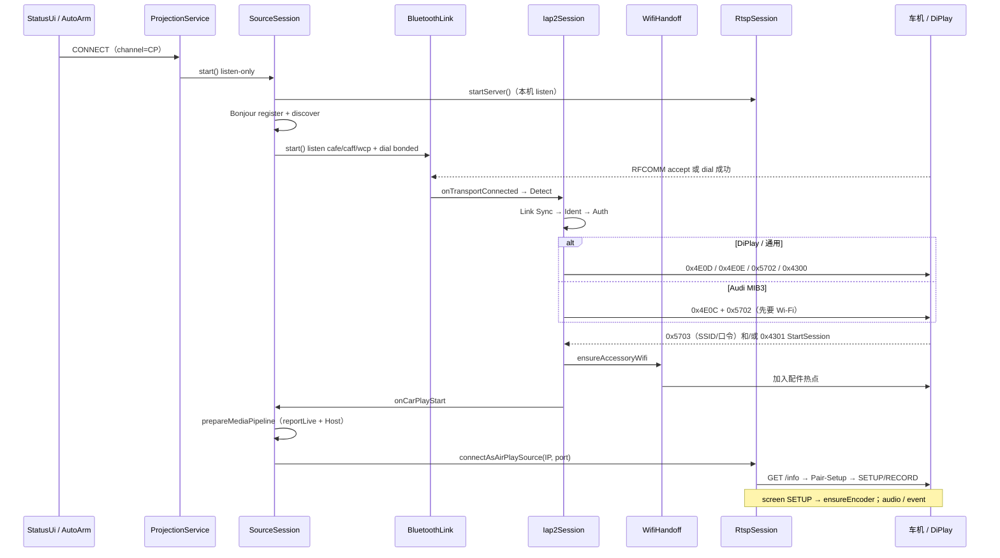

# 无线 CarPlay 连接逻辑

> 角色：本模块 = **Source（假 iPhone）**；车机 / DiPlay = **Receiver（配件）**。  
> 范围：从「选 CarPlay 通道」到「AirPlay 控制 TCP 建链 + screen/audio SETUP」的**建连时序**。  
> 出画 / 编码 / 触控 / NowPlaying 见 [EXECUTION.md §14](EXECUTION.md)；协议字节对照见 [CARPLAY_REFS.md](CARPLAY_REFS.md)；奥迪个案见 [AUDI_CARPLAY_CONNECT_ANALYSIS.md](AUDI_CARPLAY_CONNECT_ANALYSIS.md)。

---

## 1. 一句话总览

```
状态页选 CarPlay
  → FGS 轻量武装（BT cafe + RTSP listen；不启 Host/编码器）
  → BT RFCOMM（listen …cafe / dial …caff）
  → iAP2（Detect → Link Sync → Ident → Auth → Wi‑Fi / StartSession）
  → 加入车机热点
  → AirPlay dial / screen SETUP 时才 prepareMediaPipeline（Host GL + VD + 编码 + 音频采集）
  → AirPlay/RTSP 控制 TCP（GET /info → Pair-Setup → SETUP/RECORD）
  → screen / audio / event 通道
```

没有 MFi 协处理器：Source 侧 Auth 发 `0xAA05` 成功、**不验签**。真车若强校验证书，会卡在 Auth 之后。

---

## 2. 启停入口

| 触发 | 行为 | 代码 |
|------|------|------|
| 状态页「出口通道 = CarPlay」 | `CarPlayChannel` 持久化 → `CarPlayProjectionService.CONNECT` | `CarPlayStatusUi`、`CarPlayChannel` |
| 开机 / BT ON / 解锁 | 若通道已是 CarPlay → **system_server** 尽早起 FGS listen `…cafe`（绕过 app 后台广播禁令） | `xposed/carplay/CarPlayBootArm` |
| 开机 / 换包 / 解锁（回退） | App 侧 `BOOT_COMPLETED` 阶梯武装 | `CarPlayAutoArmReceiver` |
| STOP / 切回 AA | `tearDown` → 停 Session / Host；通道改 AA | `CarPlayProjectionService` |

通道文件：`filesDir/aadisplay_carplay_channel`（`0`=AA，`1`=CarPlay）。默认 **AA**，真车行为不变。

FGS `ensureSession()`（开机 AutoArm / 切通道）只做**监听**：

1. `CarPlaySourceSession.start()` → BT cafe + RTSP listen（**不** `reportLive`、**不** Host、**不** MediaCodec）
2. AutoArm / BootArm 传 `launchHostTrampoline=false`

真正建连时 `prepareMediaPipeline(reason)`（硬约束顺序）：

1. `ProjectionSessionGate` + `reportCarPlaySessionLive(true)`（先于 Host，避免 Coolwalk 压小 VD）
2. `CarPlayHostRuntime.ensureStartedSync`（GL / 双 VD）
3. screen SETUP → `ensureEncoder` → MediaCodec + GL attach

触发点：AirPlay TCP probe 成功 / Bonjour dial / screen SETUP（兜底）。

会话存活：app 内 `ProjectionSessionGate`；system_server 经 `CoreApi.reportCarPlaySessionLive` → Delay Destroy 挂起 + `CarPlayProcessBoost` + 音频采集。

---

## 3. 连接时序（端到端）



并行注意：

- **RTSP listen + Bonjour** 在 BT 握手前就起来；主路径仍是 `0x4301` 后 Source dial。
- Bonjour 解析到对端 `_carplay-ctrl._tcp.` 也会 `rtsp.connect`（辅路径；忽略本机 `AADisplay-CarPlay`）。
- RFCOMM 断开 → 停媒体流 + NowPlaying，便于对端重 Auth。

---

## 4. 分层说明

### 4.1 蓝牙 RFCOMM（`CarPlayBluetoothLink`）

协议 UUID（Apple 常量，集中在 `CarPlayConsts`，不是某车机魔法值）：

| UUID | 角色 | 谁 dial |
|------|------|---------|
| `…deafdecacafe` | Phone（本机 listen） | 车机 / DiPlay 回连 |
| `…deafdecacaff` | Accessory（本机也可 listen；并对 bonded dial） | 本模块首连 HU |
| Wireless CarPlay capability | SDP/EIR 能力广告 | —（VAG 等缺此 UUID 不出 CarPlay） |

身份与车机策略（`carplay/profile/`）：

- **`CarPlaySourceIdentity`**：iAP/AirPlay 手机字段（默认 `iphone14_2`）；不改 BT 适配器名。
- **`CarPlayHuProfile`**：dial 策略、AirPlay UA/HKP/版本、MIB3 vs Generic 无线路径。
- **`CarPlayProfileResolver`**：按 iAP ident → SSID → BT 名（registry 内 hint）解析 HU；未命中 → `generic`。
- 新手机 / 新车机：改注册表，禁止在 BT/iAP/RTSP 再写 `contains("audi")` / `"iPhone14,2"`。

武装时：

- 不改蓝牙适配器名称；尽量 `SCAN_MODE_CONNECTABLE_DISCOVERABLE`。已有 inbound-preferred 车机 bond 时**不弹**系统「可被发现」对话框。
- BT OFF 时挂 `STATE_CHANGED`，ON 后再 `beginRfcomm`（避免 reboot 永久放弃 → DiPlay SDP `scn=0`）。
- bonded 扫描 dial `…caff`（按 accessory / wireless-CP UUID 排序）。`INBOUND_PREFERRED`（Audi）：**优先等车机 dial `…cafe`**；仅 **BOND_BONDED**（及 start 时已 bonded）启动 **2.5s 一次性** `…caff` fallback，**等满才置 `headUnitDialPending`**（等待窗内 4s 循环不得出站；ACL 不拨）。`BOND_BONDING` 禁拨（否则掐 SSP）。**已有 socket / iAP 协商中禁止红 dial**；Detect/SYN 重试耗尽无 ACK 则拆 RFCOMM，避免 zombie `…caff` 挡住 cafe。
- 配对：已知 HU（名 hint / 已 bonded 且含 CarPlay UUID）经 `prepareCarPlayHeadUnit` 由 **system_server** `setPairingConfirmation` 静默确认并 `abortBroadcast`，不弹 Settings；**禁止**在 `PAIRING_REQUEST` 上 `removeBond`（会逼每次重配）。
- 保留 HFP；**不主动开 A2DP**（部分 HU 会超时提示「无法建立蓝牙」）。

### 4.2 iAP2 状态机（`protocol/Iap2Session`）

| 阶段 | 要点 |
|------|------|
| Detect | 本机先发 `FF 55 02 00 EE 10`；探测重传 |
| Link Sync | `FF 5A` SYN/ACK，协商 MTU / session（control + file transfer） |
| Identification | `0x1D00` → 收 `0x1D01` → `0x1D02` |
| Auth | `0xAA00…05`；本模块不验签。MIB3：证书请求与 20B challenge 同批 |
| Wireless | 见下；MIB3 与 DiPlay **顺序不同** |

**DiPlay / 通用**（Auth 后立刻）：

```
0x4E0D WirelessCarPlayUpdate AVAILABLE
0x4E0E DeviceTransportIdentifier（BT MAC）
0x5702 RequestAccessoryWiFiConfiguration
0x4300 CarPlayAvailability（wireless）
→ 等 0x5703 和/或 0x4301
```

**MIB3**（`HuProfile.id=mib3`；registry hint 含 audi/mmi，仅经 Resolver）：

```
0x4E0C wireless session id + 0x5702   ← 先要热点
→ 收 0x5703 → 加入 Wi‑Fi
→ 0x4E0D / 0x4E09(name=iPhone) / 0x4E0E / 0x4300
→ 等 0x4301；2.5s 未见到则重发 0x4300；Wi‑Fi bound 后再发一次
```

`0x5703` → `CarPlayWifiHandoff.ensureAccessoryWifi`；`0x4301` → `dialCarPlayControl`（有 SSID 则等 Wi‑Fi ready）。

### 4.3 Wi‑Fi handoff（`CarPlayWifiHandoff`）

- `WifiNetworkSpecifier` 加入配件 AP；**勿 unregister 活着的 Specifier**（One UI 会立刻掉 L2）。
- 用本地回调 **hold** 住无 INTERNET 的 AP，避免三星 `CMD_UNWANTED_NETWORK` 2–3s 踢线。
- 入网前 `CoreApi.preferCellularOverUnvalidatedWifi`，避免未验证 STA 抢默认路由掐蜂窝。
- dial 前走 `CarPlayAccessoryNet` 绑到配件 Network，禁止走 LTE 默认路由撞 `10.x`。

**连热点仍走流量（默认路由 vs socket 绑网）** 的完整梳理见 [CARPLAY_WIFI_CELLULAR.md](CARPLAY_WIFI_CELLULAR.md)。

### 4.4 控制 TCP / AirPlay（`CarPlayRtspSession`）

`dialCarPlayControl`：

1. 优先 `0x4301` 里非 link-local IPv4；否则 DHCP/网关 hint。
2. 最多约 12 次 TCP probe + `connectAsAirPlaySource`（失败且未绑 Wi‑Fi 则再 kick handoff）。
3. Source dial：`GET /info` → Pair-Setup（MIB3 用偏旧 UA/HKP）→ Pair-Verify → 加密 SETUP/RECORD。
4. 本机也可 accept 入站 RTSP（Bonjour / 对端主动连）。

出画在 SETUP screen 之后；连接文档到此为止。后续见 EXECUTION §14.1。

---

## 5. 类职责速查

| 类 | 连接职责 |
|----|----------|
| `CarPlayChannel` | AA ↔ CarPlay 互斥通道持久化 |
| `CarPlayBootArm`（system_server） | BT ON / 解锁时起 FGS（首连关键） |
| `CarPlayAutoArmReceiver` | BOOT_COMPLETED / 换包回退武装 |
| `CarPlayProjectionService` | FGS 拥有 Session；live 上报 |
| `CarPlaySourceSession` | 编排 Bonjour + BT + iAP2 + Wi‑Fi + RTSP |
| `CarPlayBluetoothLink` | RFCOMM listen/dial、名称/可发现、配对监听 |
| `Iap2Session` / `Iap2Framing` / `Iap2Csm` | iAP2 成帧与状态机 |
| `CarPlayWifiHandoff` | 配件热点加入与 hold |
| `CarPlayBonjour` | `_carplay-ctrl._tcp.` 注册/发现 |
| `CarPlayRtspSession` | RTSP listen + AirPlay Source dial |
| `CarPlayAccessoryNet` | 配件 Network 上开 TCP |
| `ProjectionSessionGate` | app 侧 CP live 位 |

---

## 6. 常见断点（排查顺序）

| 现象 | 优先查 |
|------|--------|
| 车机只有普通蓝牙电话，无 CarPlay | RFCOMM 是否真正连上（`…cafe` accept / `…caff` dial）；通道是否 CarPlay；看 `AAD_CpBootArm start FGS` 是否早于 Audi SDP |
| 开机第一连不上、第二才能连 | BT ON 时 app `STATE_CHANGED` 被拒；需 system_server BootArm + 重启换模块 |
| DiPlay 有声无屏 / SDP `scn=0` | 本机是否在 listen `…cafe`（BT 未 ON 就放弃过） |
| Auth 后无热点 / 无 StartSession | 是否 MIB3 路径；是否已发 `0x5702`；是否收到 `0x5703`/`0x4301` |
| 有 Wi‑Fi 且久无 `0x4301` | 主路径仍等 StartSession；约 8s 后才看 `_airplay` 缓存 / 网关:7000 **兜底** |
| pair-setup HTTP 403 | 主路径仍先 setup；403 时才重连 + verify + `X-Apple-PD`（查 `files/airplay_identity/`） |
| 有 StartSession 但 dial 失败 | Wi‑Fi 是否 bind；是否走了蜂窝；IPv4 是否只有 `fe80` |
| 连上又秒断 AP | Specifier hold 是否被 unregister；三星 UNWANTED |
| GL/编码很热闹但车机无会话 | 旧 DiPlay RFCOMM 占着 socket，对新车 dial 被丢弃 |

日志标签：`CarPlayConsts.TAG`（`AADisplay_CarPlay` 一类）。关键字样：`RFCOMM`、`iAP`、`WiFi handoff`、`CarPlayStartSession`、`AirPlay source dial`。

### 6.1 CarDeck 协议坑 → **只加固，不替代主路径**

主路径仍是我们已验证的：`0x4301` dial、MIB3 `OPTIONS→/info→pair-setup→verify`、事件通道收 `hidSendReport`、profile 定 MFi 挑战长度。下表仅为兜底，**不得抢主路径、不得改已通时序**。

| 加固项 | 行为 | 明确不做 |
|--------|------|----------|
| 无 `0x4301` | Wi‑Fi bind 后**缓存** `_airplay`；**≥8s 仍无 StartSession** 才 dial / 网关:7000 | 一发现 mDNS 就 dial；挡 StartSession |
| ctrl TXT `id` | 写真实 BT MAC；绑网 force 重注册 | 改 RFCOMM / Ident 主逻辑 |
| pair-setup 403 | 捕获 403 → 重连 + 持久控制器 verify；`X-Apple-PD: 1` | 跳过 setup；跳过 MIB3 预热 /info |
| `hidSetInputMode` | `/info` 有 hidDevices 时额外武装 | 臆造 `"0"`/`"1"`；替代现有触控解析 |
| MFi 挑战记忆 | 本进程跳过已拆链长度 | 改写 MIB3 默认 20B / DiPlay 32B 优先 |

未搬：modesChanged 改 SETUP 前；`awaitAck=false`；用 CarDeck 会话状态机替换 `Iap2Session`。

---

## 7. 与其它文档的分工

| 文档 | 内容 |
|------|------|
| **本文** | 建连时序与断点 |
| [CARPLAY_WIFI_CELLULAR.md](CARPLAY_WIFI_CELLULAR.md) | 配件 Wi‑Fi 无网 + 整机继续走蜂窝 |
| [EXECUTION.md §14](EXECUTION.md) | 运行时出画 / 音频 / 触控 / 包边界 |
| [CARPLAY_REFS.md](CARPLAY_REFS.md) | 外部协议参考与字节序 |
| [CARPLAY_MAC_TEST.md](CARPLAY_MAC_TEST.md) | Mac Simulator 联调 |
| [AUDI_CARPLAY_CONNECT_ANALYSIS.md](AUDI_CARPLAY_CONNECT_ANALYSIS.md) | 奥迪 MMI 连不上的监测与计划 |
| [archive/usb-carplay/](../archive/usb-carplay/) | **有线** USB fake-iPhone（WIP，默认关闭 / UI 隐藏） |
