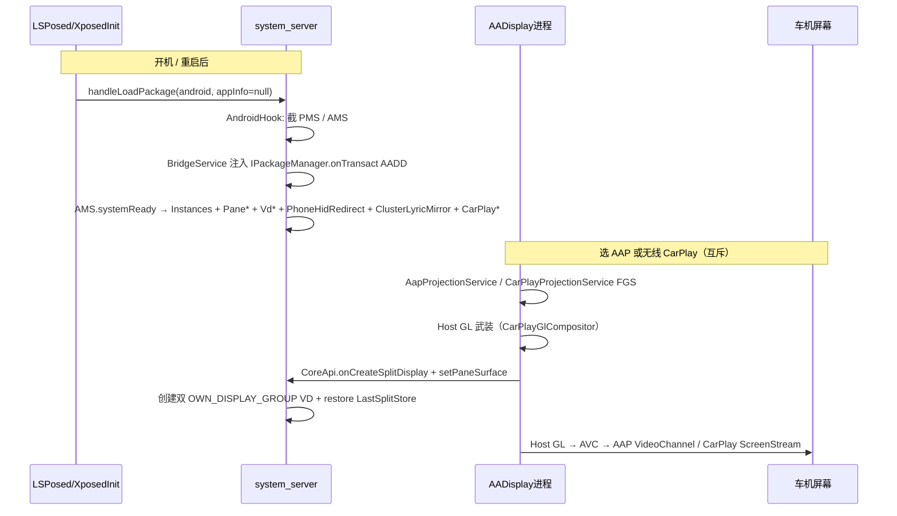
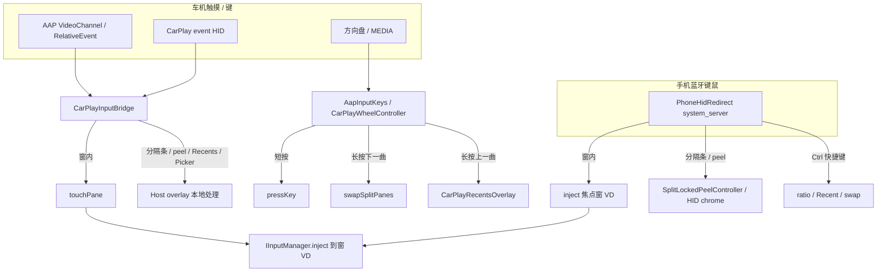
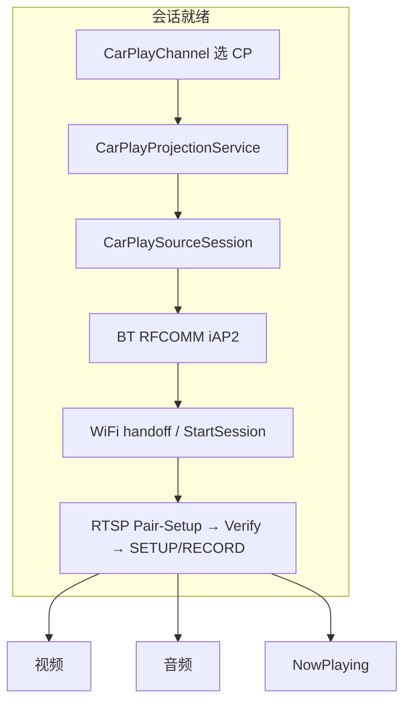

# EXECUTION.md — AADisplay 运行时逻辑链路

给后续 AI / 开发者用的**执行顺序文档**。仓库地图、改动硬规则、LSPosed scope 见根目录 [AGENTS.md](../AGENTS.md)。  
**改显示、IPC、钩子、触控、会话生命周期前先读本文**，再动代码。

路径均相对仓库根。Kotlin 源码默认在 `aa-display/src/main/java/io/github/nitsuya/aa/display/`。

---

## 0. 先建立的心智模型

本模块不是普通 App：它是 **LSPosed 模块**。真正干活的代码跑在 **system_server**。  
**出口仅 AAP 或无线 CarPlay**（Host 式 GL → 协议栈）。Google gearhead / Car SDK 投影已硬下线；清单见 [GEARHEAD_LEGACY.md](GEARHEAD_LEGACY.md)。

```
HU 画面      = AAP / CarPlay：Host GL（VD→OES→Compositor→编码器）→ 协议出站
应用真实窗口 = system_server 里两块独立 VirtualDisplay（PRIMARY / SECONDARY）
跨进程能力   = 只能走 CoreApi → ICoreManager（禁止在 AA / App 进程直接 createVirtualDisplay）
```

进程（再加被投应用自己的进程）：

| 进程 | 谁注入 | 常驻对象 | 禁止做的事 |
|------|--------|----------|------------|
| `system_server` | `AndroidHook` | `CoreManagerService`、`SplitDisplayController`、`DisplaySessionPolicy`、`ClusterLyricMirror` | 不要从这里 inflate 车机 UI |
| `io.github.nitsuya.aa.display` | 无 Xposed 钩子 | `AapProjectionService` / `CarPlayProjectionService` / Host GL | 不要直接操作 VD / ATMS |
| 被投 App | 无（仅 DPI pin 等 system 侧） | 任务窗口画在 VD 上 | — |

`CoreApi` 选路（`CoreApi.kt`）：**只有真正的 system_server**（`AndroidHook.isReadyForSystemHooks()`）才用 `CoreManagerService.instance`；其余一律 `CoreManager` 经 PMS 桥拿 Binder。不要用 `uid == 1000` 判断——三星等 OEM 系统应用也是 1000。

---

## 1. 总链路（从开机到车机有画面）



出画细节见 §14.3（AAP）与 §14.1（CarPlay）。Google gearhead / Car SDK 投影已硬下线：[GEARHEAD_LEGACY.md](GEARHEAD_LEGACY.md)。

---

## 2. 模块加载（Xposed 入口）

入口文件：`aa-display/src/main/assets/xposed_init`  
类：`xposed/XposedInit.kt`

1. `initZygote` → EzXHelper。
2. `handleLoadPackage` 路由，**仅** system_server；其余包（含 gearhead）不注入：

| 条件 | 对象 | 进程确认 |
|------|------|----------|
| `packageName == "android"` **且** `lpparam.appInfo == null` | `AndroidHook` | 再用 `/proc/self/cmdline == system_server`（`AndroidHook.isReadyForSystemHooks()`） |

LSPosed scope（`res/values/arrays.xml`）：`android` + 本模块包。**不要**再勾 Android Auto（gearhead）。gearhead APK 仅供 AAP 证书提取。

---

## 3. system_server 起桥（没有这一步，车机 UI 全是空转）

文件：`xposed/hook/AndroidHook.kt`、`xposed/BridgeService.kt`

```
ServiceManager.addService("package")
  → 拿到 IPackageManager
  → BridgeService.register(pms)
  → hook IPackageManager.onTransact
  → code == 'AADD' 且 uid == 本模块
  → reply.writeStrongBinder(CoreManagerService.instance)

AMS 构造 → 捕获 system UI Context → CoreManagerService.systemContext
AMS.systemReady → Instances.init + PanePresentationGuard + VdImeDisplayPin + VdOrientationFill
                 + PhoneHidRedirect + ClusterLyricMirror + CarPlayAudioCapture / ProcessBoost / BootArm
```

客户端拿 Binder：`xposed/CoreManager.kt` `getService()`  
`ServiceManager.getService("package")` → transact `TRANSACTION=AADD` + `ACTION_GET_BINDER=1`。

硬约束：

- magic **`AADD`**、descriptor `android.content.pm.IPackageManager` 禁止改名。
- 只放行 **本模块 uid**（gearhead uid 白名单已删）。
- AIDL **只能在接口末尾追加** 方法，否则旧 system_server Stub 序数错位（需重装模块并重启）。
- 若干 Coolwalk / Car SDK 触控方法保留为 **no-op**（ordinal 稳定），见 [GEARHEAD_LEGACY.md](GEARHEAD_LEGACY.md)。

---

## 4. Google gearhead 钩子（已删除）

运行时 **不再** 注入 `com.google.android.projection.gearhead`。原 `AndroidAutoHook` / `Aa*Hook` / Coolwalk / DexKit / Car SDK 壳全部删除。

清单与仍保留项（证书提取、AIDL no-op）：[GEARHEAD_LEGACY.md](GEARHEAD_LEGACY.md)。  
历史 FacetBar 架构：[archive/COOLWALK_FACETBAR.md](archive/COOLWALK_FACETBAR.md)。

---

## 5. 出画进程：Host GL → 双 VirtualDisplay

### 5.1 拉起

```
状态页选 CHANNEL_AAP 或 CHANNEL_CARPLAY
  → AapProjectionService / CarPlayProjectionService FGS
  → Host Runtime 武装 CarPlayGlCompositor（双 VD → OES → GLES → encoder）
  → CoreApi.onCreateSplitDisplay(w, h, dpi, ratio, surfaces)
  → setPaneSurface(PRIMARY/SECONDARY)
  → LastSplitStore restore
```

车机触控 / 分隔条 / Recents / Picker 在 Host GL 合成层处理：`CarPlayInputBridge`、`CarPlayRecentsOverlay`、`CarPlayAppPickerOverlay`（AAP 复用同一套）。

### 5.2 创建分屏显示

软/硬连接共用 `CoreApi.onCreateSplitDisplay` → `CoreManagerService` → `SplitDisplayController` / `SplitVdLifecycle`。  
Surface 来自 Host GL 的 pane `SurfaceTexture`，不是已删除的 Car SDK `TextureView`。

### 5.3 system_server 创建 / 重连

`xposed/CoreManagerService.kt` `onCreateSplitDisplay`（切 Main）：

```
已有 SplitDisplayController？
  是 → 软重连：
      DisplaySessionPolicy.onResume()  （取消 180s Delay Destroy）
      重新绑 Surface
      onReconnected(locked profile)
      keepVirtualDisplayAwake("soft-reconnect", forceWake)
      比例仅在与当前差 ≥ 0.01 时才 setSplitRatio（AA echo 不要打回去）
  否 → 硬创建：
      resolveDisplayProfile（见不变式）
      new SplitDisplayController { onConnected(...) }
      首帧回调后再 new DisplaySessionPolicy
```

`ui/aa/split/SplitDisplayController.onConnected`：

1. `DisplayManager.createVirtualDisplay` × 2（名字 `AADisplay-P/S-*`）。
2. 先 `onCreated(primaryDisplayId)` 让 Host 绑 Surface 出画，再 post 应用 IME/旋转策略（三星 `freezeDisplayRotation` 很贵）。
3. 有合法快照则 `SplitLaunchRestore.scheduleRestoreLastSplit()`，并 `mSuppressReclaimUntil += 8s`。

VD flags（`SplitVdLifecycle.vdFlags`）——**不要加 `VIRTUAL_DISPLAY_FLAG_PRESENTATION`**（抖音 LivePlay 会把 Presentation 贴到另一窗，盖住导航并抢走焦点）：

`PUBLIC | SECURE | OWN_CONTENT_ONLY | TRUSTED | OWN_DISPLAY_GROUP | ALWAYS_UNLOCKED | TOUCH_FEEDBACK_DISABLED | SUPPORTS_TOUCH`

创建后由 `PaneDisplayGroupForce` 把 LogicalDisplay 挪出 Group 0（Lineage A16 上 PUBLIC + OWN_DISPLAY_GROUP 仍可能卡在 Group 0；同组会跟手机锁屏/ColorFade。`ALWAYS_UNLOCKED` 只对非默认组生效）。

- **需要 `PUBLIC`**：否则 `FLAG_PRIVATE`，LatinIME 等非 owner 无法在窗上建输入法窗（A16：`SHOW_SOFT_INPUT` 超时 / `WM_SET_REMOTE_TARGET_IME_VISIBILITY` 失败）。
- **不要 `OWN_FOCUS`**：A16 上会导致 IMMS 以为已 show（壳出现「收起键盘」）但 VD 上无 `TYPE_INPUT_METHOD` 窗；省略后焦点 EditText 才能正常出键盘。
- `SUPPORTS_TOUCH`：蓝牙鼠标 viewport / `setVirtualMousePointerDisplayId` 需要。

分屏时 **VD 缓冲 = 窗格尺寸**（HU × ratio − 分隔条）。全屏时两 VD 都是满 HU 缓冲，Host 只合成可见侧、背后那块继续渲染。  
不要改回「两窗都满幅再 crop」——半窗会变成全屏布局的中心切片 + 黑边。

### 5.4 Display profile lock（重连分辨率）

`CoreManagerService.resolveDisplayProfile`：**锁定客户端上报尺寸**（AAP / CarPlay Host 上报的 w×h×dpi）。

- 软重连：同方向只允许变大；方向变了才 relock。
- 真正 `onDestroyDisplay` 走完才 `clearDisplayProfileLock`。
- 旧 Coolwalk FacetBar / content-slot settle（`DisplayProfileSettle` / `reportCoolwalkRailSnapshot`）已删除；历史见 [archive/COOLWALK_FACETBAR.md](archive/COOLWALK_FACETBAR.md)。

---

## 6. 会话生命周期（断线 ≠ 立刻拆 VD）

`ui/window/DisplaySessionPolicy.kt`（无手机悬浮窗）

| 事件 | 行为 |
|------|------|
| 首创成功 | Monitor wake lock（每块 VD 一把自己的 display-scoped `SCREEN_BRIGHT`）+ heartbeat |
| Host / FGS 拆显示会话 | `CoreApi.onDestroyDisplay` → `policy.onDestroy` → **延迟 180s** 再 `controller.onDestroy()` |
| 180s 内重连 | `onResume`：`cancelAndJoin` 销毁任务，VD 复用 |
| 180s 到 | 释放 lock、拆 VD、清 profile lock、forceStop 窗内应用 |
| 手机 SCREEN_OFF | 立刻 keep-awake；完整约 4s burst 最短间隔 **8s**（抖动时跳过加固循环）；heartbeat 改为 3s |
| 手机主屏触控/按键 | 重置伪熄屏 idle（`PowerManagerService.userActivity` display 0） |
| 手机主屏前台用户应用（如地图） | **跳过**伪熄屏 `goToSleep`；回桌面后再计时 |
| 手机主屏为桌面/锁屏/SystemUI | 伪熄超时 = `min(SCREEN_OFF_TIMEOUT, **10s**)`，缩短误触亮屏窗口 |
| 触控/按键（车机 / VD） | `onVirtualDisplayUserInteraction`（1s 节流）；**不**续手机伪熄屏 |

Keep-awake 硬规则：

- 窗 VD **不许停在 ColorFade/OFF**（三星 `OWN_DISPLAY_GROUP` 会跟手机一起 doze）。
- `IPowerManager.userActivity` **只走带 displayId 的四参重载**；禁止全局 overload（会亮手机主屏）。
- 伪熄屏：系统 idle 被 VD 全局锁挡住时，对 display 0 `goToSleep`；无手机 FG 用户应用时超时上限 **10s**（`min(SCREEN_OFF_TIMEOUT, 10s)`），有地图等 FG 应用则跳过；计时锚点 = 亮屏 / 会话开始 / **主屏** TOUCH·BUTTON·A11Y；车机操作不重置。
- `ACQUIRE_CAUSES_WAKEUP` 只做短 pulse，不要长持。
- 手机 `SCREEN_OFF`：每次立刻单次 keep-awake；完整 reassert burst 最短间隔 **8s**。

`SplitDisplayController.onDestroy`：先 persist 快照 → 卸 TaskStackListener → `removeTask` 窗内任务 → `forceStopPackageAsUser` → `VirtualDisplay.release`。

---

## 7. IPC 地图

契约：`aa-display/src/main/aidl/.../ICoreManager.aidl`  
实现：`CoreManagerService`（system_server）+ `CoreManager`（客户端代理）

| 方法 | 调用方典型场景 | 落到 |
|------|----------------|------|
| `onCreateSplitDisplay` | AAP / CarPlay Host 武装 | 创建或软重连 |
| `setPaneSurface` | Host pane SurfaceTexture | `VirtualDisplay.surface =` |
| `setSplitRatio` / `getSplitRatio` | 分隔条松手 | resize VD；全屏中只改 `mRatioBeforeFullscreen` |
| `setSplitFullscreen` / `getSplitFullscreenPane` | 拖过边缘 / peel | 两 VD 满幅或按比例 |
| `getPanePackage` / `setFocusedPane` / `getFocusedPane` | 空窗 / Recent 焦点 | 栈顶包名；焦点窗记录 |
| `swapSplitPanes` | 点分隔条 / 方控长按下一曲 | 整栈 `moveRootTask` 对调，**VD 身份不变** |
| `startActivity` / `startActivityOnPane` | Picker / Recent 点选 | `PaneAppStack.pushToTop` + 启动或置顶 |
| `moveTaskId` / `moveTaskIdToPane` / `moveTaskToFront` | Recent 拖拽 | 跨 display 搬任务 |
| `removeTask` | Recent Close | 关任务；栈顶空则下一档 |
| `pressKey` | 方控短按 | 注入到焦点窗 |
| `hideIme` **oneway** | Host「收起键盘」 | WMS/IMM hide |
| `getImePane` | IME chip 同步 | -1 隐藏；0/1 为正在显示 IME 的窗 |
| `touchPane` **oneway** | Host / AAP 触控 → 窗 | 注入对应 VD |
| `touchPrimaryPane` / `touchAaDisplay` / `reportAaUiDisplayId` | — | **no-op**（AIDL ordinal 保留） |
| `reportCoolwalk*` / `notifyCoolwalkFullBleed` | — | **no-op**（AIDL ordinal 保留） |
| `getRecentTask` | `CarPlayRecentsOverlay` | 左=PRIMARY 栈，中=SECONDARY，右=手机 |
| `reportCarPlaySessionLive` | AAP / CarPlay 会话 | 二次出口 live → Delay Destroy 门控 |

`touchPane` 是 oneway：返回只表示 parcel 已入队。`CoreManager.tryTouchPane` 失败时 **不要吞掉 HU 事件**。

---

## 8. 分屏控制器内部（system_server 真源）

`ui/aa/split/SplitDisplayController.kt` 是门面，状态机拆到同目录协作类：

| 类 | 职责 |
|----|------|
| `SplitVdLifecycle` | flags、按比例算尺寸、resize、IME/旋转、keep-awake overlay |
| `SplitLaunchRestore` | restore / persist / ensure 空窗 / 校验 |
| `SplitOwnership` | ATMS 任务搬家、reclaim、bringToFront、1px nudge 铺满 |
| `SplitInputRecents` | `IInputManager.injectInputEvent`、Recent 列表 |
| `SplitImeController` | 轮询窗 VD 上 IME 可见性，广播给 Host（`ACTION_IME_VISIBILITY`）；`hideIme` 不抢任务焦点 |
| `PaneAppStack` | 每窗最多 3 个，底→顶，栈顶=画面 |
| `SplitTaskStackListener` | 栈变 → debounce reclaim + persist + 驱逐外窗 Presentation |
| `SplitLockedPeelController` | 手机锁屏时 Host presentation 被 Keyguard 挡住，全屏 peel 在 system_server 直接解析 |
| `SplitPresentationGuard` | 外包 `TYPE_PRESENTATION` 贴到本窗 VD → 拦 `addWindow` / `attachWindowContextToDisplayArea` |
| `SplitChromePackages` | 不参与 bounce/reclaim 的壳包名 |

主线程：`mHandler`（Main）。Binder 进来的 `swap` / `startActivity` / `moveTask*` 先 `runIO` 再 `runOnHandlerBlocking`，避免和 reclaim 抢。

### 8.1 多应用栈

`PaneAppStack`：

- 顺序 **底 → 顶**；`last()` = 正在显示 = `mPanePackages[pane]`。
- 同包不能同时在左右两栈。
- 满 3 再 push → 挤掉栈底并关掉对应任务。
- Launch / Recent 点选 = **压栈或置顶**，不是杀旧再开。
- 同步 ATMS 时必须先 `SplitOwnership.normalizeRootTasksBottomToTop`。三星 `getAllRootTaskInfosOnDisplay` 经常是 **顶→底**，且要用 `RootTaskInfo.visible`，不能假设 `lastOrNull` 就是前台。

高德：LAUNCHER 常是 `UsbFillActivity`，VD 上实际是 `MainMapActivity`。`bringTaskToFront` 必须按 **现有 task 的 topActivity** 重排并校验真成顶，失败就清僵尸再冷启，禁止把失败切换写成栈顶。

### 8.2 restore

`SplitLaunchRestore.restoreLastSplitNow`：

1. 读 `LastSplitStore`（Settings.Global 优先，失败再 `/data/system/aadisplay_last_split.properties`）。
2. 按快照比例 resize（先不要全屏）。
3. 每窗按 **底→顶** `startActivityOnPane`，再 `setStackBottomToTop`，再把快照 front `bringTaskToFront`。
4. 最后才 `setSplitFullscreen`。
5. 2s / 再 2s 校验 front 是否真在对应 display 上，最多 3 次；失败给空窗选择器。

Persist key **禁止改名**（已有设备快照）：`aadisplay_last_split_left/right/ratio/fullscreen` + `*_stack` CSV。历史名 left/right = PRIMARY/SECONDARY。

### 8.3 reclaim

任务栈一变就想把「属于本窗的包」拉回来。下列窗口必须抬高 `mSuppressReclaimUntil`（常量：`SUPPRESS_RECLAIM_AFTER_RESTORE_MS=8s`，一般操作 `SUPPRESS_RECLAIM_MS=2s`，ratio/swap 等处也有约 0.8s）：

- restore 后 8s
- ratio / fullscreen / swap 后约 0.8–2s
- 用户主动把任务搬去手机

否则会出现：刚划走又弹回、restore 过程中被旧 ATMS 顺序覆盖。

---

## 9. 车机 UI 手势（Host GL：`CarPlayInputBridge`）

分隔条 / peel（合成层，非已删除的 `SplitDividerView` Fragment）：

| 手势 | 分屏 | 全屏（peel） |
|------|------|----------------|
| 拖动 | 预览比例，**松手**才 `setSplitRatio` | 向外 peel；松手超 `FULLSCREEN_EXIT_RATIO` 则退出 |
| 点按 | `swapSplitPanes` | 只切可见窗，**不搬栈** |
| 长按 | 开 `CarPlayRecentsOverlay` | 同左；锁屏走 `SplitLockedPeelController` → `showHidRecentTask` |

拖过边缘：常量见 `SplitPane`。退出全屏顺序：**先** `setSplitRatio` **再** `setSplitFullscreen(NONE)`。

空窗短按 → `CarPlayAppPickerOverlay.show(pane)` → `startActivityOnPane`。  
窗内触控 → `CoreApi.touchPane`（归一化坐标由 `CarPlayInputBridge` 映射）。

---

## 10. 输入路径（不要混）



### 10.1 手机蓝牙键鼠（操作说明）

前提：键鼠**连手机**；显示会话活跃（非 Delay Destroy）；改钩子后需**重启**（`system_server`）。实现：`xposed/hook/PhoneHidRedirect.kt`。

光标在 **双窗合成画布**上连续移动（`[左窗][分隔条][右窗]`）；inject 进各 pane VD。几何来自 `SplitDisplayController.hidSplitLayout()`（活体 VD 尺寸）。

**鼠标**

| 操作 | 效果 |
|------|------|
| 窗内移动 / 主键点击 | 触控注入当前窗格 VD |
| 移到两窗**中间分隔带**停住再拖 | 调分屏比例（预览，松手 `setSplitRatio`） |
| 分隔带上**长按再松手** | 打开 Recents（`showHidRecentTask` / Host overlay） |
| 分隔带**短按** | 对调两窗 |
| **中键** | 光标跳到另一窗中心并切焦点 |
| 全屏某一窗 | 只在该窗内移动；peel 带见 `HidSplitLayout.isPeelHit` |

**键盘**（须按住 **Ctrl**；放行 Power / Volume / Home / Back）

| 快捷键 | 效果 |
|--------|------|
| Ctrl + ← / → / ↑ / ↓ 或 WASD | 比例 ±5%（`nudgeHidSplitRatio`） |
| Ctrl + R 或 Ctrl + Tab 或 App Switch | Recents（`showHidRecentTask`） |
| Ctrl + S | 对调两窗 |
| 其它物理键 | `inject` 到当前焦点窗 |

**折叠屏 / 多面板注意**

- 系统实体屏光标：`forceHideCursor`；可见指针由 Host GL 每帧拉 `getHidCursorOverlay` 画到 chrome（`CarPlayChromePainter.drawHidCursor`；原 `HidCursorOverlayView` / AaDisplayActivity 已随 gearhead 下线）。
- 窗需 Input viewport：VD 带 `VIRTUAL_DISPLAY_FLAG_SUPPORTS_TOUCH`；另 hook `setDisplayViewports`。
- **懒启用（A16）**：无外接鼠标时**不**装 `InputFilter`。检测用 `(sources and SOURCE) == SOURCE`。
- 日志标签：`AAD_PhoneHid`。

### 10.2 方控映射

- **AAP：** `aap/AapInputKeys` — 短按媒体键 `pressKey`；长按 NEXT 换窗；长按 PREV Recents。
- **CarPlay：** `CarPlayWheelController` — 同 UX；MIB3 物理右常报 HID PREV → `invertMediaLeftRight`。

`pressKey` / 触控 DOWN / HID 注入会 `DisplaySessionPolicy.onVirtualDisplayUserInteraction`。

---

## 11. Recent 三列

入口：分隔条 / peel 长按、方控长按上一曲 → `CarPlayRecentsOverlay`（Host GL 画布三列）。

`CoreApi.recentTask`：

- 左 = PRIMARY 窗栈（顶在前）
- 中 = SECONDARY
- 右 = 手机 DEFAULT_DISPLAY

点卡片 → `startActivityOnPane` / `moveTaskToFront`；Close → `removeTask`。  
左/中底栏「添加应用」→ `CarPlayAppPickerOverlay`。

---

## 12. 系统侧辅助钩（仅 system_server，随会话装）

`VdDensityPin`：`DisplaySessionPolicy` init 时 `ensureHooked`，真正拆 VD 才 `unHook`。  
把跑在 AA VD 上的进程 `Configuration.densityDpi` 钉成窗 DPI。AA 重连 **不得** `clear` 映射表，否则双窗密度中途掉线。

`VdMetricsMirror`：`systemReady` 时装一次。pinned 包查询 `DEFAULT_DISPLAY` 的 `DisplayInfo` 时，把 `logicalDensityDpi` 改写成当前 VD 有效 DPI（堵 `getDefaultDisplay().getMetrics()` 绕过）。必须 copy 再改，禁止原地 mutate。装钩 / 热路径失败或熔断后静默降级，仅靠 `VdDensityPin`。

`PanePresentationGuard`：`systemReady` 时装一次。拦外包往本窗 VD 贴 `TYPE_PRESENTATION`（典型：抖音 LivePlay + MediaRouter）。

`VdImeDisplayPin`：`systemReady` 时装一次。AA VD 上的 client 要键盘时，IME 窗/token 必须落在同一 VD（纠正 OEM 把目标改写到默认屏，如三星合盖 `isFolded`→0）。无 decor 时同时 hook `DisplayContent.getImePolicy` + WMS，仅把 **FALLBACK→LOCAL**（勿改写 HIDE/INVALID，否则空 show）。
另：蓝牙硬键盘连接时 LatinIME 默认不展软键盘（`onEvaluateInputViewShown` → 壳「收起键盘」但 `mImeHeight=0`）。会话期临时打开 `show_ime_with_hard_keyboard`（销毁后恢复）。
`PaneDisplayGroupForce` 在挪组后**就地**同步 `mOverrideDisplayInfo.displayGroupId`（勿清 `mInfo`：A16 上是 final `DisplayInfoProxy`，赋 null 会 NPE 重启 system_server）。

`PhoneHidRedirect`：`systemReady` 装钩；AA 会话 live 时**仅当检测到外接鼠标**才启用 InputFilter + viewport 注入（键盘可走 key hook）。Delay Destroy / teardown / 拔掉鼠标关闭。操作说明见 §10.1。
外接键鼠仍可能因 policy `FLAG_WAKE` 点亮手机主屏；**禁止**在 `interceptMotion*` 上改 policyFlags / 吞 `userActivity(0)`（Lineage A16 上会把指针路由打回手机）。

`PaneDisplayGroupForce`：`applyPolicies` 后把窗 LogicalDisplay 挪出 Group 0，使 `ALWAYS_UNLOCKED` 生效、锁屏不同步到车机。

---

## 13. 广播总线（`util/AABroadcastConst.kt`）

Car SDK / Coolwalk / gearhead 总线已删。现行仅：

| Action | 方向 | 用途 |
|--------|------|------|
| `IME_VISIBILITY` | system_server → 本模块 | Host「收起键盘」chip（`CarPlayImeChip`）；`EXTRA_PANE` |

`AaSystemBroadcast.toAaDisplay` 只投本模块包。system_server 发送前经 `AndroidHook` 对 `aa.display.action.*` 白名单，避免 A14+ WTF dump。

---

## 14. 二次出口（AAP / 无线 CarPlay）

目标：同一套双 VD / 分屏，经 **AAP** 或 **无线 CarPlay Source** 出到车机（互斥；无 Google gearhead 投影）。

```
应用窗口 → system_server VirtualDisplay
         → 通道互斥（同一时刻只出一路）:
            AAP（已装 AA 时默认）：Host GL → AVC → AapSourceSession / VideoChannel
            CarPlay：Host GL → AVC → CarPlaySourceSession
                     （Bonjour _carplay-ctrl._tcp. + BT iAP2 + RTSP）
```

### 14.1 播放链路（速查）

会话先就绪，再出画 / 出声 / 出元数据。协议栈在 **AADisplay 进程**；采集与 cgroup 两个能力在 **system_server**（经 `CoreApi` 门控）。



**视频（屏）**

```
CarPlay Host（唯一 CP 出画路径，GPU 零拷贝）:
  VD → SurfaceTexture(OES) → CarPlayGlCompositor（GLES 双窗+分隔条 @供给 fps）
    → MediaCodec createInputSurface → ScreenStreamEgress → 车机

临时回退（Host Runtime 未就绪）:
  FrameEgressTee 测试图案 → 同上编码器（`prepareMediaPipeline` 在 AirPlay dial / SETUP 时武装 Host；空闲 AutoArm 仅 BT+RTSP listen）
```

- SETUP `type=110` 后连 `dataPort`；密钥 = HKDF(pairVerify.shared, `DataStream-Salt{id}`, …)。
- 帧率状态机在 `CarPlaySourceSession`（60↔30）；**不重发 SETUP**。DiPlay 解码帧率自持，车机需设 60fps。
- **出画互斥**：`CarPlayChannel` AA XOR CarPlay；无 AA 壳双通道 tee。GL/VD 由 `CarPlayHostRuntime`（FGS 拥有）在 `prepareMediaPipeline` 时武装（非开机空转）；`CarPlayHostActivity` 仅可选 trampoline。日志 `feed=gl-compositor`（正常）/ `feed=tee-canvas`（仅 Runtime 未挂上时）；`CarPlayGlCompositor rate ~XXfps`（仅 encoder attach 后）。

**音频（media ⊕ speech，互斥内容）**

```
USAGE_MEDIA/GAME/UNKNOWN/NOTIFICATION*/ALARM/ACCESSIBILITY/VOICE_COMMUNICATION*/RINGTONE
  → media ring（48k stereo）
     1) AudioPolicy RENDER|LOOP_BACK → REMOTE_SUBMIX（真改道，不 mute；含通话下行/铃声）
     2) PlaybackCapture + MediaProjection（采不到通话 usage）
     3) REMOTE_SUBMIX AudioRecord（回退）
  → pullCarPlayAudio → egress media（SETUP audioType=media 0x8000 / 奥迪 type-102 AAC）
USAGE_ASSISTANCE_NAVIGATION_GUIDANCE / ASSISTANT / SONIFICATION
  → speech ring（16k mono；AudioPolicy RENDER|LOOP_BACK→REMOTE_SUBMIX；与 media 同 policy 或单独）
  → pullCarPlaySpeechAudio → egress speech（SETUP audioType=speech 0x10；MIB3 不开）
```

- 奥迪 MIB3：只开 type-102 AAC-LC media（`CarPlayAacAudioEgress`），不开 speech PCM（奥迪混音器会静音）→ 通话/铃声走 media mix。
- 其它车机：type-100 media（`0x8000` 48 kHz stereo）；speech（`0x10` 16 kHz mono）仅在 `CoreApi.isCarPlaySpeechCaptureReady()` 时打开。无内容发静音。**禁止** media→speech 镜像 / 双路 remotesubmix（DiPlay 混出重音）。
- AudioPolicy 不可用时 speech 保持静音（导航提示缺席优于重音）；MediaProjection 采不到 NAVIGATION / 通话。
- Mute：仅 playback-capture → stream mute（含 VOICE_CALL/RING）+ local-device mute；`audio-policy-render` → **不** mute；remotesubmix 回退 → **不**静音。
- 范围：手机→车机 **播放**（含通话下行）；车机麦上行 / 完整 CarPlay 电话协议不在此路径。
- MediaProjection：system_server 内勿走 `BinderService.createProjection`（同进程 `checkCallingPermission` 恒拒）；直接构造服务内 `MediaProjection`（三星无 `createProjectionInternal`）。
- 采集启停跟 `reportCarPlaySessionLive`：HU dial / screen SETUP 置 true；FGS tearDown，或媒体链路结束（peer close / TEARDOWN / AirPlay control 结束，约 4s 内未再 SETUP）置 false 并恢复手机音量。仅 UDP egress 停不停采集。会话仍 live 时 ignore egress disable。`setStreamMute` 由 system uid 持有，不恢复则关模块也要重启才能动音量。

**NowPlaying（仪表卡 / 歌词行）**

```
ClusterLyricMirror（system_server）
  → ClusterLyricStore / ClusterArtStore（Settings.Global）
  → CarPlayNowPlaying（app 观察）
  → iAP2 0x5001 增量（title=当前歌词行）
  → 封面：会话 12 文件传输（SETUP→START→DATA+FLAG_LAST→SUCCESS）
```

- Host 发 `0x5000` 后才推流；与 AAP `AapNowPlaying` **同源**（`ClusterLyricStore`），出口为 iAP2。

**触控 / 方控（回传，非播放）**：event 通道 HID → `CarPlayInputBridge` / `CarPlayWheelController` → `CoreApi.touch*` / `pressKey` / `scrollPane`。

| 组件 | 路径 |
|------|------|
| FGS / 启停 | `carplay/CarPlayProjectionService.kt`（Intent `CONNECT` / `STOP`；系统重启仅在选择 CarPlay 通道时重武装） |
| 通道选择 | `carplay/CarPlayChannel.kt`（files 持久化；已装 AA 默认 AAP，未装默认 CarPlay；`CHANNEL_AA` 已退役） |
| 会话编排 | `carplay/CarPlaySourceSession.kt` |
| 发现 / 链路 | `CarPlayBonjour`、`CarPlayBluetoothLink`（RFCOMM dial+listen）、`CarPlayRtspSession` |
| iAP2 | `protocol/Iap2Framing` + `Iap2Csm` + `Iap2Session`：detect → Link Sync → Ident → Auth(`AA00…05`) → WiFi/`4300`→`4301`；`CarPlayWifiHandoff` 尝试加热点 |
| 编码 / Host | `CarPlayVideoEncoder`（60fps；1280×720 时 `bitrateFor` 落在 8 Mbit 下限；Surface 优先；`ENCODE_*`=1280×720；`KEY_LOW_LATENCY`/`CAPTURE_RATE`/`REPEAT_PREVIOUS_FRAME_AFTER`；High + `I_FRAME_INTERVAL_SEC=1`）、Host：`CarPlayGlCompositor`（VD→OES→GLES→encoder @60；`carplay/gles/*`）、Host 未就绪临时：`FrameEgressTee` 测试图案；`ScreenStreamEgress` 同步 TCP + 每帧 flush（异步合并 flush 会灌爆 DiPlay） |
| 帧率自适应 | `CarPlaySourceSession`：8×10s 劣化（<50% 或丢帧 >15%）60→30，6×10s 良好 30→60；不重发 SETUP（DiPlay 忽略 fps，**车机需 设置→显示→帧率=60**） |
| 音频出站 | system_server `CarPlayAudioCapture`（media：优先 AudioPolicy RENDER\|LOOP_BACK→REMOTE_SUBMIX，覆盖娱乐+通知+闹钟+**通话下行/铃声**；否则 PlaybackCapture（无通话）→ REMOTE_SUBMIX；speech：nav/assistant 同 RENDER，失败静音；mute 仅 playback-capture（含 VOICE_CALL/RING）；5min 看门狗）。奥迪 MIB3：仅 type-102 AAC media（通话也走 media）。其它：type-100 media + 条件 speech。无车机麦上行 |
| NowPlaying | `CarPlayNowPlaying.kt`（观察 `ClusterLyricStore`/`ClusterArtStore` Settings.Global → iAP2 `0x5001` 增量：title=当前歌词行（仪表 8s 字幕）、artist/album/source/duration/elapsed 1s tick；封面走 iAP2 v2 文件传输会话 12：SETUP→START→DATA(FLAG_LAST)→SUCCESS，≤2MiB，`CoreApi.getClusterArtJpeg` 取字节） |
| iAP2 扩展 | `Iap2Session`：`0x5000` 订阅接收、`sendNowPlaying`、会话 12 路由 + 发送窗口流控（对端 maxOutgoing 累积 ACK，队列封顶）；`Iap2Framing` LSP 含 `(0x0C, kind 1, ver 2)` |
| 方向盘 | event 通道 HID → `CarPlayWheelController`（与 AA 同 UX）：短按切歌 `pressKey`；**长按右/下一曲=`swapSplitPanes`**；**长按左/上一曲=Recents**；滚轮 `scrollPane`。MIB3 物理右常报 HID PREV → `invertMediaLeftRight` 对调后再按 AA 语义处理 |
| 仅 CP Host | `CarPlayHostActivity`（无 UI 壳：双 SurfaceTexture → `CarPlayGlCompositor` GLES 合成 + 分隔条/全屏 peel + Recents/Picker 纹理叠加；`LastSplitStore` 快照恢复 + 演示应用兜底） |
| 触控回传 | `CarPlayInputBridge` → `CoreApi.touchPane` / Host chrome（分隔条 / peel / Recents / Picker） |
| Recents | `CarPlayRecentsOverlay.kt`（画布三列：左 PRIMARY / 中 SECONDARY / 右 phone） |
| 应用选择器 | `CarPlayAppPickerOverlay.kt`（Canvas 直绘；AAP/CP 共用） |
| 会话仲裁 | `egress/ProjectionSessionGate`（app，**二次出口** live：CarPlay ∪ AAP）+ `reportCarPlaySessionLive`（AIDL 名冻结；system_server → `DisplaySessionPolicy.onSecondaryEgressLiveChanged`：存活期间 Delay Destroy 挂起，结束且无 AA UI 附 → 重启 180s 倒计时）＋ `xposed/carplay/CarPlayProcessBoost.kt`（存活期把 app pid 写入 `cpu`+`cpuset`+`freezer` 的 top-app，3s 重断言；仅写 cpu 时三星会进 `cpuset:/abnormal` 砍半核） |
| 状态页 CarPlay UI | `carplay/CarPlayStatusUi`（`MainActivity` 只 `bind` / `refresh` / `handleLaunchIntent`） |
| 音频采集（system） | `xposed/carplay/CarPlayAudioCapture.kt`（原 `xposed/hook/`，已迁出以免与 AA 钩子混放） |

### 14.2 包边界（AAP 与 CarPlay）

目标：协议 / 编码 / Host 留在 `carplay/`（AAP 出画复用）；`ui/aa/split` 不 import 协议细节；共享 `egress/ProjectionSessionGate` 与 `CoreApi`。

```
ui/aa/split/     → CoreApi                              （分屏真源）
aap/             → CoreApi + carplay Host GL（出画/触控复用）
carplay/         → CoreApi + egress/ + Cluster*（读）
xposed/carplay/  → 仅 system_server 能力，经 ICoreManager 门控
```

| 允许共享 | 禁止 |
|----------|------|
| `CoreApi` / 双 VD / `SplitPane` / `LastSplitStore` / `ClusterLyricStore`（读） | 把 iAP2/RTSP/加密搬进 system_server |
| `egress/ProjectionSessionGate` | 恢复 gearhead DexKit / Car SDK 壳 |
| AIDL `reportCarPlaySessionLive` 等（名称冻结，ordinal 稳定） | 新增 gearhead 进程钩子 |

**不变式补充**

- CarPlay **协议栈**（iAP2 / RTSP / 加密 / 音频 RTP / 文件传输）只跑在 AADisplay 进程的 `carplay/`。两个 **系统能力**例外：`xposed/carplay/CarPlayAudioCapture` 与 `CarPlayProcessBoost`。不要把协议逻辑搬进 system_server。
- 出画 **互斥**：选 AAP 则停 CarPlay Source/Host；选 CarPlay 则停 AAP。
- 不 vendor CatPlay / 不开 CarLife 包名伪装；LSPosed scope = `android` + 本模块。
- Source dial（对 DiPlay）：persistent Pair-Setup M1–M6 → Pair-Verify → 加密 SETUP/RECORD → `eventPort`（Events-* ChaCha：forceKeyFrame / HID 触控）→ `dataPort` screen 流（DataStream ChaCha 密钥来自 pair-verify shared + avcC CONFIG + AVC）。FairPlay AES 路径仍需真机抓包对照。
- screen 128B 头 **NTP 32.32 = little-endian**、event 通道 `Events-Input/Output` 密钥**互补交换**（对照 DiPlay 真机解密布局；方向写反即对端持续 `BAD_DECRYPT`）。
- encoder `start()/stop()` 会并发释放 codec：drain / converter 线程对 codec 的调用必须整次隔离异常（released codec 的调用 FATAL 会崩进程）；`ensureEncoder` 同 tick 重复调用要按「已在目标尺寸运行」去重。

**连接时序 / 外部协议参考**

- [docs/CARPLAY_CONNECT.md](CARPLAY_CONNECT.md) — **无线建连专篇**：启停 → BT RFCOMM → iAP2 → Wi‑Fi handoff → AirPlay dial；DiPlay vs MIB3 差异与常见断点。
- [docs/CARPLAY_REFS.md](CARPLAY_REFS.md) — 以 [45clouds/WirelessCarPlay](https://github.com/45clouds/WirelessCarPlay)（MIT）的 iAP2 / CarPlay / BT 配件 / 认证 PDF 与 mDNS 为主；对照本模块 `Iap2Framing`、`CarPlayBonjour`、`CarPlayRtspSession`，并说明与「RPi USB 中继」角色差异。
- [docs/CARPLAY_MAC_TEST.md](CARPLAY_MAC_TEST.md) — Mac CarPlay Simulator（Host）组网联调步骤 + `tools/carplay-test/carplay_probe.sh` 分层探测（Bonjour / RTSP / btsnoop）。

**真机验证状态（对 DiPlay 0.2.19，双机）**：screen 解码出画（`first decrypted frame` → decoder render）、event 通道长活、触控往返（Host tap → Source `event touch` → 窗格）、audio 通道建立。画面供给帧率受 **Source 手机 app cgroup** 影响（后台 2–4fps / 前台 11–15fps）——CarPlay 会话存活期由 `CarPlayProcessBoost` 提权 top-app 缓解；**60fps 需要在车机 DiPlay 设置→显示→帧率=60**（DiPlay 解码帧率自持，忽略 Source SETUP fps）。

状态页（`MainActivity` → `CarPlayStatusUi`）「出口通道」单选 **Android Auto（AAP）/ 无线 CarPlay**（已装 AA 默认 AAP；互斥出画）。

---

### 14.3 Android Auto（AAP）开机→出画

细节与证书策略见 [AAP_NATIVE.md](AAP_NATIVE.md)。与 CarPlay 共用 Host GL / 触控桥 / `CarPlayAudioCapture` / 二次出口 live 位。

```
状态页 CHANNEL_AAP（或已装 AA 默认）
  → PhoneCertStore.ensureExtracted（读 gearhead APK，不装钩子）
  → AapProjectionService FGS
  → AapSourceSession：无线 BT bootstrap / USB AOA
  → TLS + ServiceDiscovery
  → VideoChannel.onVideoStart
  → AapDisplayBridge：CarPlayGlCompositor + CarPlayVideoEncoder
  → CoreApi.onCreateSplitDisplay + setPaneSurface + LastSplitStore restore
  → ProjectionSessionGate.setCarPlayLive(true) + reportCarPlaySessionLive(true)
       （Delay Destroy 挂起、ProcessBoost、AudioCapture arm）
  → 帧 → AAP VideoChannel.sendFrame
  → 触控 → CarPlayInputBridge.injectNormalized → touchPane / chrome
  → 音频 → AapAudioEgress ← pullCarPlay*
  → 歌词 → AapNowPlaying ← ClusterLyricStore
```

| 组件 | 路径 |
|------|------|
| FGS / 会话 | `aap/AapProjectionService.kt`、`aap/AapSourceSession.kt` |
| 出画 | `aap/AapDisplayBridge.kt`（复用 `carplay/` GL+AVC） |
| 触控 / 键 | `CarPlayInputBridge`、`aap/AapInputKeys.kt` |
| 音频 / NP | `aap/AapAudioEgress.kt`、`aap/AapNowPlaying.kt` |
| 证书 | `aap/cert/PhoneCertStore.kt`、`AaApkKeyExtractor.kt` |
| 协议 | `vendor/aare-aap` |

---

## 15. 改代码时的不变式（违反就会回归已修过的真机 bug）

1. 跨进程显示 **只经** `CoreApi` / `ICoreManager`。
2. 不要给 VD 加 `VIRTUAL_DISPLAY_FLAG_PRESENTATION`。
3. 分屏 VD 尺寸 = 窗格尺寸；全屏才双 VD 满缓冲。
4. Profile lock：软重连只允许同方向变大；尺寸取客户端上报（非 Coolwalk rail）。
5. Delay Destroy = **180s**；keep-awake 覆盖 Delay Destroy 全程。
6. `userActivity` 禁止无 displayId 的全局调用。
7. AIDL 只追加；`touch*` 保持 oneway；Coolwalk / presentation 孤儿方法保持 no-op。
8. `LastSplitStore` / Binder magic `AADD` / `xposed_scope` 禁止改名。
9. ATMS 列表先规范成底→顶；front = visible / last after normalize。
10. 分隔条拖动不要 live `setSplitRatio`；退出全屏先 stash ratio 再一次 resize。
11. 长按开 Recent 必须 **UP 之后**；开之前 `resetGesture`。
12. **不要**恢复 gearhead DexKit / `AndroidAutoHook` / Car SDK 壳。
13. 不要重新引入 `aadisplay_config` SharedPreferences。
14. 不要在 App 进程申请 Magisk `su`。
15. 新钩子：仅 system_server / 本模块需要时 `object` + `BaseHook`，`tagName` = `AAD_*`。
16. CarPlay **协议**不进 system_server（系统侧仅 `CarPlayAudioCapture` / `CarPlayProcessBoost` / `CarPlayBootArm`，会话门控）；出画 AAP XOR CarPlay（Host GL 独占）。

---

## 16. 按任务从哪读起

| 要改什么 | 从这些文件顺着读 |
|----------|------------------|
| 开机 / 作用域 / 进哪个进程 | `XposedInit.kt`、`AndroidHook.kt` |
| 无线 CarPlay 出口 / 播放链路 | §14 / §14.1 / §14.2、[CARPLAY_CONNECT.md](CARPLAY_CONNECT.md)、[CARPLAY_REFS.md](CARPLAY_REFS.md)、`carplay/`、`egress/ProjectionSessionGate`、`xposed/carplay/` |
| Android Auto（AAP）出口 | §14.3、[AAP_NATIVE.md](AAP_NATIVE.md)、`aap/`、`vendor/aare-aap` |
| Binder 拿不到 / 未激活 | `BridgeService.kt`、`CoreManager.kt`、`CoreApi.kt`、`MainActivity.kt` |
| 双窗创建 / 闪烁 / 尺寸 | `AapDisplayBridge` / `CarPlayHostRuntime`、`CoreManagerService` profile lock、`SplitVdLifecycle` |
| 断线黑屏 / 亮手机 / 180s | `DisplaySessionPolicy.kt` |
| 分屏比例 / 全屏 peel | `CarPlayInputBridge`、`SplitLockedPeelController`、`setSplitFullscreen` |
| 启动应用 / 栈 / 杀错进程 | `PaneAppStack`、`SplitLaunchRestore`、`SplitOwnership` |
| Recent 三列 | `CarPlayRecentsOverlay`、`getRecentTask` |
| 快照恢复错误 | `LastSplitStore.kt`、`restoreLastSplitNow`、ATMS 底→顶 |
| 方控 | `AapInputKeys`、`CarPlayWheelController` |
| 手机蓝牙键鼠 | §10.1、`PhoneHidRedirect.kt`、`HidSplitLayout.kt` |
| 仪表横条歌词 | [CLUSTER_LYRIC_CLOCK.md](CLUSTER_LYRIC_CLOCK.md)、`ClusterLyricMirror`、`AapNowPlaying` / `CarPlayNowPlaying` |
| 抖音盖导航 / 外窗 Presentation | `PanePresentationGuard`、`SplitPresentationGuard` |
| AA VD 键盘落错屏 / 合盖无键盘 | `VdImeDisplayPin` |
| 应用 DPI 不对 | `VdDensityPin`、`VdMetricsMirror` |
| 已删 gearhead 原路 | [GEARHEAD_LEGACY.md](GEARHEAD_LEGACY.md)、[archive/COOLWALK_FACETBAR.md](archive/COOLWALK_FACETBAR.md) |
| 隐藏 API | `lib-stub/` + `Instances.kt`（Rikka Refine） |

行为变更与真机回归清单：[README.md](../README.md)（用户向）、[CHANGELOG.md](../CHANGELOG.md)、[docs/archive/](archive/)。
